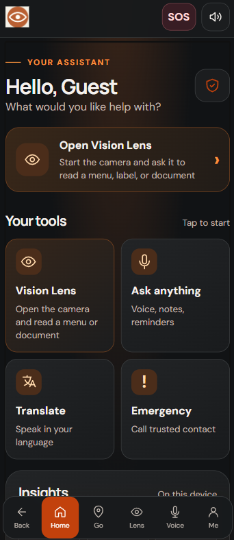
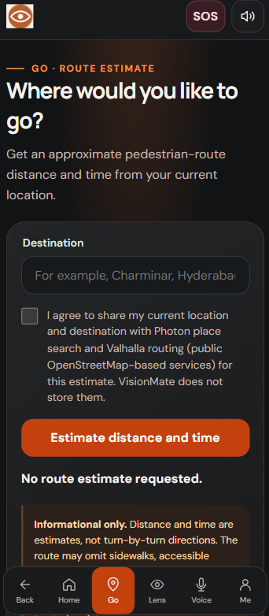
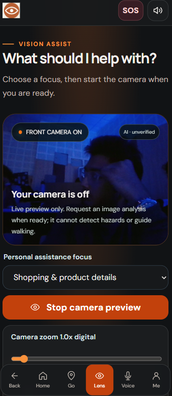
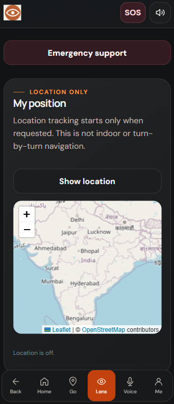
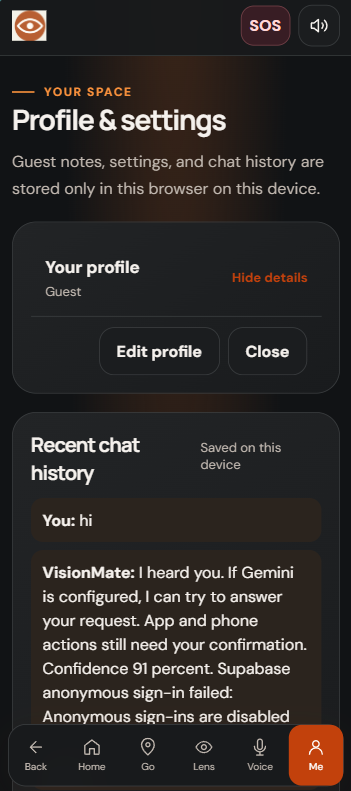

# VisionMate

VisionMate is an accessible, voice-first web companion for blind and low-vision people. It brings together camera-based visual assistance, text reading, translation, approximate route estimates, notes, reminders, and emergency contacts in a mobile-friendly interface.

**Try VisionMate:** [visionmate.vercel.app](https://visionmate.vercel.app)

VisionMate is an installable website (PWA), not a native Android app. It does not control other apps, listen for background wake words, read hardware volume buttons, or display over other apps.

<p align="center">
  
</p>

## Get started

1. Open [visionmate.vercel.app](https://visionmate.vercel.app) in a current mobile or desktop browser. Use HTTPS for camera, microphone, and location features.
2. Choose **Continue as guest** to start without creating an account. Guest profile information, notes, reminders, and chat history stay in that browser on that device.
3. Explore using the large on-screen controls or supported voice commands. If spoken feedback does not play, interact with the page once; browser autoplay policies may block audio until then.
4. Sign in from **Me** only if account sync is configured and you want your information associated with an account.

Camera and microphone access are requested only when you start a feature. Vision Lens asks before starting the camera. Go asks for location permission only when you request an estimate and consent to share your location. You can deny a permission and continue using other available features.

### Install on a phone

- **Android (Chrome):** Open the site, open the browser menu, and choose **Install app** or **Add to Home screen**.
- **iPhone/iPad (Safari):** Tap **Share**, then **Add to Home Screen**.

Browser menu wording varies. The app shell can be cached for offline entry, but AI, translation, maps, and route services require an internet connection.

## Mobile controls

The fixed navigation bar stays at the bottom of the app:

| Control | What it does |
|---|---|
| **Back** | Returns to the previous VisionMate screen |
| **Home** | Opens the main assistant screen |
| **Go** | Opens the route-estimate screen |
| **Lens** | Opens Vision Lens; start the camera when ready |
| **Voice** | Opens the voice assistant |
| **Me** | Opens profile, language, voice, and settings |
| **SOS** | Opens the emergency support screen |
| **Audio button** | Turns spoken feedback on or off |

In **Voice**, press and hold the on-screen **Talk** button while speaking, then release it. If your browser supports speech recognition, you can also use its voice-input control; typed input is available where shown. For example, you can ask VisionMate to read text or open a supported screen. Browser speech-recognition support and available device voices vary.

In **Lens**, start the camera preview yourself, choose the available camera/zoom controls, and request analysis or text reading when ready. The app sends a still image for analysis when you request it; optional monitoring works only while explicitly enabled and the page stays open.

In **Go**, enter a destination and approve the location request to get an approximate walking route, distance, and time. The map supports normal touch gestures. This is not turn-by-turn navigation.

Use ordinary page scrolling and browser pinch zoom. Mobile browsers control permission dialogs; VisionMate cannot grant operating-system permissions for you.

## What VisionMate can do

- **Voice-first interaction:** Press-and-hold speech input, supported browser speech recognition, typed requests, and spoken responses.
- **Seven interface/voice languages:** English, Hindi, Tamil, Telugu, Kannada, Malayalam, and Punjabi. Device speech requires an installed voice for the selected language; Gemini voice requires cloud setup.
- **Vision Lens:** User-started camera preview and requested image questions or text reading.
- **Route estimates:** Consent-gated location and destination lookup, with approximate pedestrian route display on a map.
- **Everyday tools:** Profile settings, local or account-synced notes, reminders, chat history, translation, trusted contacts, and emergency support.
- **Guest mode:** Use available local features without Firebase sign-in.
- **Installable PWA:** Add VisionMate to a supported device’s home screen for an app-like launch experience.

## Product showcase

<p align="center"></p>
<p align="center"></p>
<p align="center"></p>
<p align="center"></p>
<p align="center"></p>
<p align="center"></p>
<p align="center"></p>
<p align="center"></p>
<p align="center"></p>
<p align="center"></p>
<p align="center"></p>

## Safety, privacy, and limits

- AI image descriptions, OCR, translations, routes, generated speech, and answers may be incorrect or unavailable. Do not rely on VisionMate to identify hazards, judge people-related risks, guide walking, or decide when it is safe to cross a road.
- Routes are approximate public pedestrian routes. They are not checked for sidewalks, accessibility, closures, or hazards and do not provide turn-by-turn guidance. Continue using a cane, guide dog, trusted assistance, and validated navigation aids.
- Camera analysis requires an internet connection and sends a requested still image to the configured AI service. Avoid capturing people or private information without consent. The people-privacy setting does not blur images.
- Guest data is stored locally in the current browser. Account sync requires the optional Firebase/Supabase configuration.
- Emergency features can present phone/contact actions but do not dispatch emergency services. Background reminders are not guaranteed after the browser closes.
- Android accessibility services, background wake-word listening, hardware-button shortcuts, and display-over-other-apps controls require a separately developed native app and explicit operating-system permissions.

## Run locally

The frontend is plain HTML, CSS, and browser JavaScript modules. There is no root frontend `package.json` or frontend `npm install` step.

1. Install Node.js.
2. Copy `.env.example` to `.env` and set the public `SUPABASE_URL` and `SUPABASE_ANON_KEY`. Add Firebase Web App values only if enabling sign-in.
3. Generate the ignored browser config:

   ```powershell
   node scripts/build-config.mjs
   ```

4. Serve the repository root using VS Code Live Server or another local static web server, then open its local URL. For example, if Python is already installed:

   ```powershell
   py -m http.server 8000
   ```

   Visit `http://localhost:8000`.

Do not add Gemini, Bhashini, Anuvaadhub, Supabase service-role, or Firebase Admin credentials to frontend configuration, source code, or Git. Provider secrets belong in Supabase **Edge Functions → Secrets**.

## Backend setup and deployment

Cloud AI and language features require a configured Supabase project, enabled anonymous sign-ins, deployed Edge Functions, and provider secrets. Firebase sign-in and account sync are optional.

Follow the [Firebase and Supabase setup guide](./my%20Firebase%20and%20Supabase%20setup%20instructions.md) for the project-specific steps. It covers Supabase migrations and function deployment, the optional Firebase setup, public frontend configuration, and hosting. The Supabase project reference is `bwxvnkutnjagqsivuqbz`.

This repository can be deployed as a static site to Vercel or Firebase Hosting. The existing `firebase.json` configures Firebase Hosting; do not run `firebase init` over it unless you intend to replace that configuration. On Vercel, use `node scripts/build-config.mjs` as the build command and `.` as the output directory.

## Technology

- **Frontend:** HTML, CSS, JavaScript ES modules, browser Web APIs
- **Authentication and data:** Optional Firebase Authentication; Supabase Auth, Postgres, and row-level security
- **AI and language:** Supabase Edge Functions proxying Gemini, Anuvaadhub, and optionally Bhashini
- **Maps and routes:** Leaflet, OpenStreetMap, Photon, and Valhalla
- **PWA:** Web manifest and service worker

## Project structure

```text
.
├── index.html
├── assets/                 # Logo, icons, and app preview images
├── css/styles.css          # Layout, responsive styling, and accessibility
├── js/                     # App screens, voice, camera, auth, data, and routes
├── functions/              # Optional Firebase callable function
├── supabase/
│   ├── functions/          # Gemini, Bhashini, and Anuvaadhub Edge Functions
│   └── migrations/         # Database schema, RLS, and Firebase identity
├── scripts/                # Public runtime-config generator
├── manifest.json
├── sw.js
└── firebase.json
```

## License and contact

No license file is currently included in this repository. For product inquiries, support, or collaboration, use the contact information on the [VisionMate website](https://visionmate.vercel.app) or contact the project team through its organization.

---

VisionMate aims to make everyday digital assistance more accessible, clear, and user-controlled.
